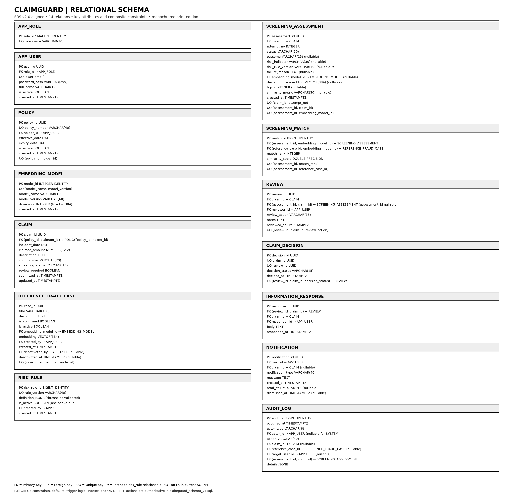

# ClaimGuard — ER Diagram and Relational Schema (v5)

**Requirements baseline:** `ClaimGuard_FINAL_SRS.pdf`, SRS v2.0 (23 October 2026).  
**Database implementation baseline:** `claimguard_schema_v4.sql`.  
**Purpose:** a polished, submission-ready data-model reference with explicit distinction between implemented database structures and remaining SRS traceability gaps.

> **Status and grading integrity.** This document improves the data-model presentation and aligns its entity set to the SRS. The images are diagrams of the current v4 SQL plus one explicitly marked conceptual relationship gap. They are not evidence that every SRS requirement has passed integration testing. The risk-rule version is currently stored as text in `screening_assessment`; the SQL does **not** yet enforce a foreign key to `risk_rule`. See §7.

## 1. ER diagram — ClaimGuard data model

**Notation:** `PK` primary key; `FK` foreign key; `UQ` unique key; `†` means a relationship intended by the SRS but not yet enforced by an FK in the current SQL. `1:N` means one-to-many; `0..1` means optional participation. Composite foreign keys are shown in their labels where important to integrity.

The ER model includes the 14 persistent entities present in the current v4 schema: identity and role management, policies and claims, embedding models, reference fraud cases, screening attempts and matches, versioned risk rules, reviews, decisions, information responses, notifications and audit events. Views are omitted because they are query projections rather than base entities.

## 2. Relational schema — keys and attributes

The relational-schema diagram lists each relation's key columns and core attributes, data types, and important composite-key relationships. `NULL` denotes an optional attribute. `VECTOR(384)` is the current implementation's fixed embedding dimension, not a universal requirement; changing the embedding model dimension requires a coordinated SQL migration.

### 2.1 Table inventory

| Relation | Purpose | Primary integrity mechanism |
|---|---|---|
| `app_role` | Supported roles | Restricted role vocabulary and unique role name |
| `app_user` | User identity and role | Unique normalized email; role FK; password hash only |
| `policy` | Coverage issued to a policyholder | Coverage-date check; holder FK; unique policy number |
| `claim` | Claim submitted under a policy | Composite policy-holder ownership FK; status and amount checks |
| `embedding_model` | Embedding model/version registry | Unique model/version pair; dimension check |
| `reference_fraud_case` | Confirmed synthetic reference patterns | Model FK; non-zero vector; controlled deactivation |
| `screening_assessment` | Screening attempt and advisory result | Per-claim attempt uniqueness; explicit failure state; embedding metadata |
| `screening_match` | Ranked evidence returned by screening | Same-model composite FKs; unique rank and case per assessment |
| `risk_rule` | Versioned, configurable risk thresholds | Unique version; JSON definition validation; at most one active rule |
| `review` | Adjuster actions and notes | Reviewer role guard; claim/assessment scope integrity |
| `information_response` | Append-only response to a request | Review/claim composite FK; non-empty response; append-only trigger |
| `claim_decision` | Final decision | At most one decision per claim/review; decision mirrors review action |
| `notification` | User inbox, read and dismissal state | Recipient FK; dismissal-state check; immutable message content |
| `audit_log` | Append-only operational history | Actor/target checks; composite assessment scope; database event triggers |

## 3. Relationship and cardinality summary

| Parent | Child | Cardinality | Key integrity / interpretation |
|---|---|---|---|
| `app_role` | `app_user` | 1:N | Each user has one role |
| `app_user` | `policy` | 1:N | A policy has one holder |
| `policy` | `claim` | 1:N | Composite FK ensures claimant is the policy holder |
| `claim` | `screening_assessment` | 1:N | `attempt_no` is unique within a claim |
| `screening_assessment` | `screening_match` | 1:N | Match ranks are unique within an assessment |
| `reference_fraud_case` | `screening_match` | 1:N | Same-model composite FK prevents cross-model comparison |
| `claim` | `review` | 1:N | A claim can have a review history |
| `review` | `claim_decision` | 1:0..1 | At most one final decision per review |
| `review` | `information_response` | 1:N | Responses reference the request review and claim |
| `app_user` | `notification` | 1:N | Notifications are tied to their recipient |
| `claim`, `reference_fraud_case`, `app_user`, `screening_assessment` | `audit_log` | 1:N (optional scope) | Target-kind and composite-scope checks constrain events |
| `risk_rule` | `screening_assessment` | intended 1:N | **Conceptual only:** version is text, not an FK in SQL v4 |

## 4. Relational definitions and constraints

The authoritative column-by-column DDL is `claimguard_schema_v4.sql`; do not maintain a second, divergent SQL listing inside this Markdown. The following rules are important when reading the diagram:

- **Policy ownership:** `claim(policy_id, claimant_id)` references `policy(policy_id, holder_id)`.
- **Model consistency:** `screening_match` carries `embedding_model_id` in both composite FKs, requiring the claim and reference embeddings to use the same registered model.
- **Decision consistency:** `(review_id, claim_id, decision_status)` references the corresponding review and its action; only `APPROVED` or `REJECTED` may become final decisions.
- **Failure safety:** a failed screening assessment carries a failure reason and no risk result; a missing/failed screening is not treated as LOW risk.
- **History retention:** reviews, decisions, information responses and audit rows are protected against ordinary mutation/deletion by database rules. Notification content is immutable; read/dismiss metadata may change under its trigger guard.
- **Advisory-only semantics:** similarity and risk indicators support investigation; they are not a calibrated probability of fraud and do not automatically reject a claim.
- **Vector retrieval:** cosine similarity uses pgvector's `<=>` distance operator; similarity is interpreted as `1 - cosine_distance`. Retrieval quality and index performance require measured evaluation.

## 5. Normalization notes

The schema uses surrogate primary keys and separate relations for multi-row concepts such as matches, reviews, decisions, responses and notifications. It avoids storing lists of matches or review events in a single claim row. `JSONB` is used for extensible risk-rule definitions and audit context, not as a replacement for relational identity or foreign keys.

Some controlled denormalization exists for operational reasons: `claim.claimant_id` repeats policy-holder identity so ownership can be enforced by a composite FK; `screening_match.embedding_model_id` supports same-model composite FKs; `claim.screening_status` is maintained for queue filtering; and `claim_decision.decision_status` mirrors the review action to enforce decision consistency. These choices should remain backed by their documented constraints/triggers.

## 6. SRS traceability — current status

| SRS requirement | Current schema support | Status / caveat |
|---|---|---|
| FR-02 / BR-01 — ownership and role access | Ownership composite FK and role checks | Database integrity is not a substitute for API read-side authorization; test tenant/owner isolation |
| FR-03–06 — claim intake and similarity evidence | Claim, assessment, match, model tables and constraints | Validate end-to-end service and top-k results |
| FR-07 / BR-06 / AC-11 — versioned risk scoring | `risk_rule`, JSON threshold checks, `fn_compute_claim_risk` | **Gap:** assessment version is not FK-bound to `risk_rule`; function returns a result but does not itself persist the result or bind the chosen rule version atomically |
| FR-08–09 — review and HIGH-risk approval guard | Review/decision guard plus `review_required` flag | **Verify/close:** ensure HIGH-risk approval requires a started and resolved review; a flag alone does not prove the required review sequence |
| FR-10 — transactional audit | Trigger-written audit for claim, assessment, review, decision, policy, response and notification events | Actor attribution depends on trusted transaction context for trigger-generated system/user identity; test each event and rollback behavior |
| FR-11 — reference-case management | Active/confirmed filtering and controlled deactivation | Verify admin authorization and immutable evidence in integration tests |
| FR-12 / FR-21 — operational and analytical reports | Status, review queue, risk, match-frequency, workload, aged HIGH-risk and stale-pending views | Views need fixture-based correctness tests and performance measurements |
| FR-13 — history retention | Append-only and no-delete guards | Privilege model must prevent app role from altering schema/disabling triggers |
| FR-14–15 — failure handling and validation | Explicit FAILED state, checks and state guards | Test application-visible error mapping and prohibited transitions |
| FR-16 — automatic HIGH-risk flag | `trg_high_risk_flag` sets `claim.review_required` on HIGH assessment | Confirm rule result is persisted consistently before trigger execution; ensure no automatic denial path |
| FR-17 — policy issuance | Policy table and issuance audit trigger | Current audit event is represented as a target-user event; consider a dedicated policy target if SRS requires direct policy lookup from audit |
| FR-18 — information response | `information_response` plus append-only and audit triggers | **Verify/close:** DB trigger must ensure response is by the policyholder and references an outstanding `INFO_REQUESTED` review |
| FR-19 — notifications | `notification`, recipient index and read/dismiss guards | User-specific access is primarily enforced in API queries/authorization; test cross-user reads and dismissal attempts |
| FR-20 — full-text search | GIN index on `to_tsvector('english', description)` | Verify ranked query and filters; index alone does not implement the API |
| FR-22 — retry and recovery | Attempt uniqueness, status guards and `v_stale_pending_screening` | Bounded retry/backoff and idempotency keys remain application/orchestrator responsibilities; test concurrency |
| NFR-06 — indexed retrieval performance | Partial HNSW index | **Not proven by schema alone:** record timing, approximate-vs-exact recall and filtered top-k behaviour on the target environment |

## 7. Prioritized improvements before calling the model final

1. **Bind assessments to immutable risk-rule versions.** Add a foreign key from `screening_assessment.risk_rule_version` to `risk_rule.rule_version` (or store `risk_rule_id` directly). Prevent mutation/deletion of published rules and define how active-rule selection is serialized with screening.
2. **Make risk computation atomic and reproducible.** Compute from persisted matches, record the exact rule version used, persist the resulting risk in the assessment, and only then set `review_required` for HIGH. Avoid a race where the active rule changes between selection and recording.
3. **Enforce the HIGH-risk review sequence.** Define the SRS-compatible meaning of “review started and resolved”; enforce it in a guarded procedure/trigger and test attempts to approve without it. Do not auto-deny claims.
4. **Harden information-response authorization.** Require an outstanding information request for the same claim and the responder to be that claim's policyholder; keep response history append-only.
5. **Complete audit target semantics.** If policy-level audit retrieval is required, add `policy_id` as a target and update the one-target/action-target constraints. Do not overload `target_user_id` as the only policy link without documenting that compromise.
6. **Verify notification authorization.** Enforce ownership in API queries and test that users cannot read or dismiss another user's notification.
7. **Run repeatable integration tests.** Load the DDL into a disposable PostgreSQL + pgvector database; test every applicable FR/AC, transaction rollback, role boundaries, concurrent retry, high-risk approval guard and reporting views.
8. **Record real evaluation evidence.** Add measured top-k retrieval recall/latency, test counts, test dataset description and known limitations. Never state results that were not actually observed.

## 8. Diagram scope and implementation caveats

- The ER PNG shows all 14 tables in `claimguard_schema_v4.sql`; a dashed relationship denotes the intended `risk_rule` ↔ `screening_assessment` association which is **not currently a database FK**.
- The relational-schema PNG displays attributes and key constraints; the SQL file remains authoritative for full nullability, defaults, checks, trigger behavior, indexes and exact FK actions.
- Reporting views are intentionally omitted from both entity diagrams.
- The fixed vector dimension (`384`) is an implementation assumption that must match the embedding model used by the service.
- Do not label this model “100/100” without an evaluator rubric and successful test evidence. The target is complete SRS traceability plus verified implementation, not visual polish alone.

## 9. Change log

- **v5:** Rebased against SRS v2.0 and the latest `claimguard_schema_v4.sql`; included the three SRS extension entities (`risk_rule`, `information_response`, `notification`); regenerated clean monochrome PNG diagrams; added explicit distinction between implemented FK relationships and the risk-rule versioning gap; expanded SRS traceability and prioritized closure plan.
