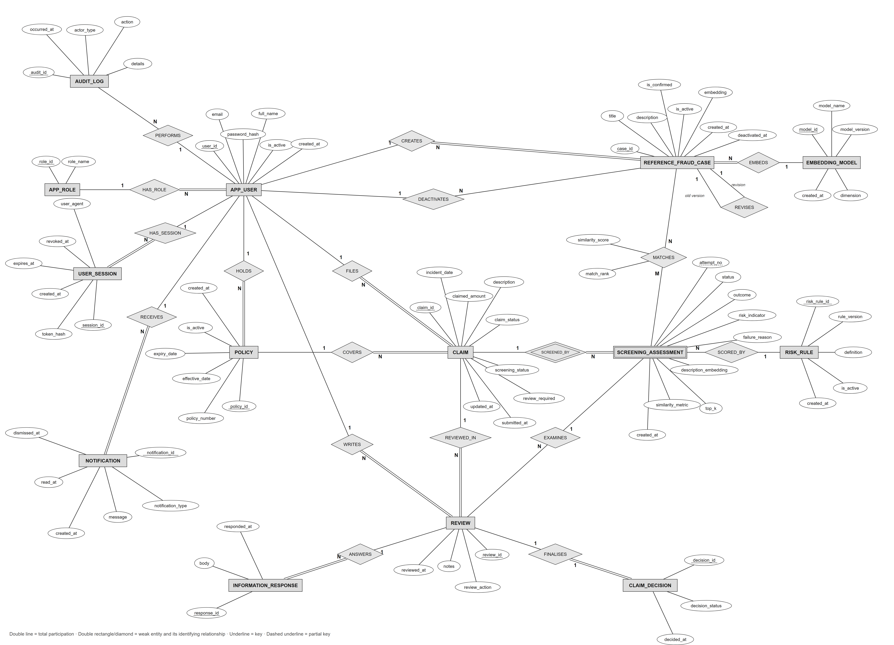
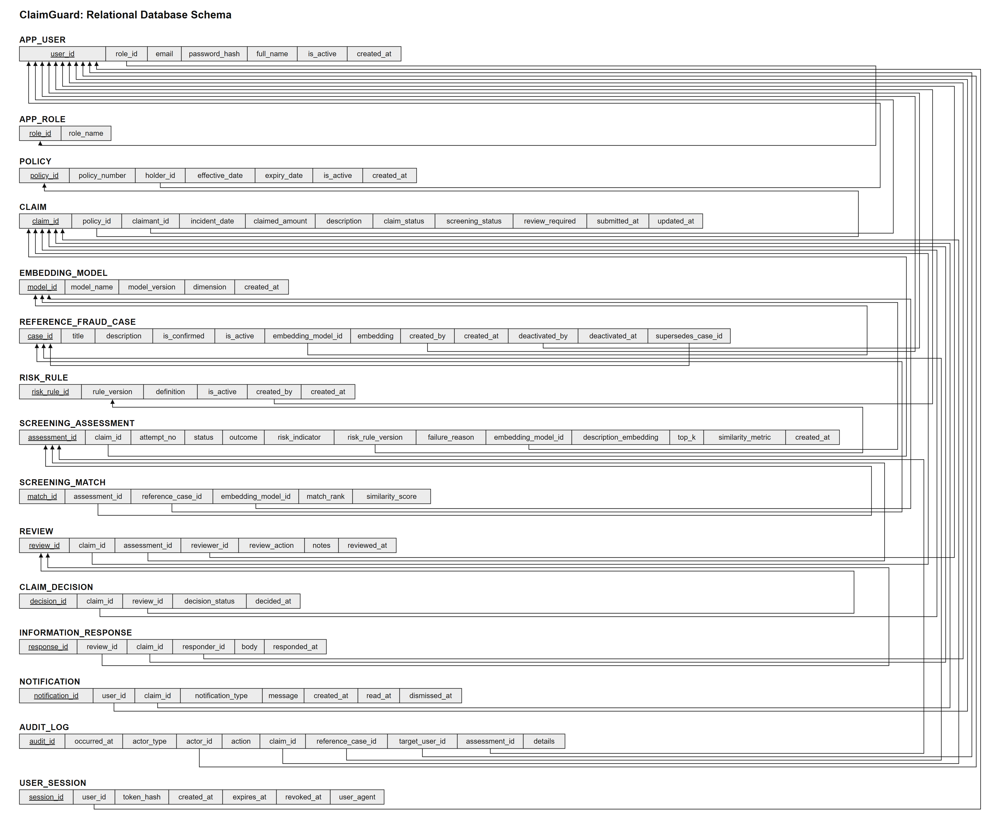

# ClaimGuard — ER Diagram and Relational Schema (v6)

**Requirements baseline:** `ClaimGuard_FINAL_SRS.pdf`, SRS v2.0 (23 October 2026).
**Database implementation:** `database/schema/claimguard_schema_v4.sql` plus migrations
`001_user_session_auth.sql`, `002_risk_rule_fk_and_procedure.sql`, `003_reference_case_versioning.sql`,
`004_workflow_guards.sql` and `005_db_roles.sql` (database roles and privileges; no schema change).
**Column-level reference:** [DATA_DICTIONARY.md](DATA_DICTIONARY.md) (every column, type and constraint, read from the database catalog).

The two diagrams below are the official ones. They describe the database after all four migrations:
15 tables, including `user_session` (migration 001) and the `reference_fraud_case` version link
(migration 003). The earlier overview images are kept in [`archive/`](archive/) for reference only.

## 1. ER diagram (Chen notation)

Source: [`ClaimGuard_ER_Diagram_Chen.svg`](ClaimGuard_ER_Diagram_Chen.svg) · PDF: [`ClaimGuard_ER_Diagram_Chen.pdf`](ClaimGuard_ER_Diagram_Chen.pdf)

**Notation:** rectangles are entities, diamonds relationships, ovals attributes. Underline = key,
dashed underline = partial key. Double line = total participation. Double rectangle/diamond = weak
entity (`SCREENING_ASSESSMENT`, identified by its claim and `attempt_no`). Foreign keys are shown as
relationships, not as attributes.

**Migration 003 addition:** `REVISES` is a recursive 1:1 relationship on `REFERENCE_FRAUD_CASE`. An
edited or re-embedded case is a new row (*revision*) that points at the row it replaces
(*old version*). Participation is partial on both sides: an original case revises nothing, and the
current version has not been revised.

## 2. Relational schema

Source: [`ClaimGuard_Relational_Schema_v6.svg`](ClaimGuard_Relational_Schema_v6.svg) · PDF: [`ClaimGuard_Relational_Schema_v6.pdf`](ClaimGuard_Relational_Schema_v6.pdf)

Each row is a relation. The underlined column is the primary key, and arrows run from a foreign key to
the key it references. `reference_fraud_case.supersedes_case_id` (migration 003) is the self-referencing
arrow into `case_id`. Both diagrams are re-exported from their SVG sources with `node scripts/export_diagrams.mjs`.

### 2.1 Table inventory

| Relation | Purpose | Primary integrity mechanisms |
|---|---|---|
| `app_role` | Supported roles | Fixed vocabulary; unique role name |
| `app_user` | User identity and role | Unique lower(email); bcrypt hash only; role-change guard; last-admin guard and status audit (004) |
| `user_session` | Server-side sessions (001) | Only a token hash is stored; max 7 days; revoke-only; revoked automatically when the user is deactivated |
| `policy` | Coverage issued to a policyholder | Unique number; `expiry > effective`; holder must be an active POLICYHOLDER; issuance audited |
| `claim` | Claim under a policy | Composite FK `(policy_id, claimant_id) → policy(policy_id, holder_id)`; immutable content; guarded state machine |
| `embedding_model` | Embedding model registry | Unique (name, version); dimension = 384 |
| `reference_fraud_case` | Confirmed fraud patterns + embedding | Non-zero vector; immutable content; one-way deactivation; **version link `supersedes_case_id` (003)**; add/deactivate audited (003) |
| `risk_rule` | Versioned risk thresholds | Unique version; JSON threshold checks; at most one active; **referenced by assessments (FK, 002)** |
| `screening_assessment` | One screening attempt | Unique (claim, attempt_no); COMPLETED/FAILED consistency checks; **`risk_rule_version` FK (002)**; append-only |
| `screening_match` | Ranked matches of an attempt | Same-model composite FKs; contiguous ranks ≤ top_k; same transaction as the attempt; append-only |
| `review` | Adjuster action | Reviewer must be an active adjuster; approval guard (002 checks + **HIGH-risk rule, 004**); append-only |
| `information_response` | Policyholder answer | Composite FK to the review; **only the claimant, only the latest open request, once (004)**; append-only |
| `claim_decision` | Final decision | One per claim; mirrors the review action via composite FK; sets the claim to DECIDED |
| `notification` | User inbox | Content immutable; read-before-dismiss; dismissal audited |
| `audit_log` | Event history | One target per event; action ↔ target checks; written by triggers; append-only |

## 3. Relationships and cardinality

| Parent | Child | Cardinality | Enforced by |
|---|---|---|---|
| `app_role` | `app_user` | 1:N | FK `role_id` |
| `app_user` | `user_session` | 1:N | FK `user_id` (001) |
| `app_user` | `policy` | 1:N | FK `holder_id` + role trigger |
| `policy` | `claim` | 1:N | Composite FK: the claimant must be the holder |
| `claim` | `screening_assessment` | 1:N (weak entity) | FK `claim_id`, unique `(claim_id, attempt_no)` |
| `risk_rule` | `screening_assessment` | 1:N, optional (NULL when FAILED) | FK `risk_rule_version → rule_version`, `ON UPDATE/DELETE RESTRICT` (002) |
| `screening_assessment` | `screening_match` | 1:N | Composite FK `(assessment_id, embedding_model_id)` |
| `reference_fraud_case` | `screening_match` | 1:N | Composite FK `(reference_case_id, embedding_model_id)` |
| `embedding_model` | `reference_fraud_case`, `screening_assessment` | 1:N | FK `embedding_model_id` |
| `reference_fraud_case` | `reference_fraud_case` | 1:0..1 (REVISES) | FK `supersedes_case_id → case_id`, `UNIQUE`, immutable (003) |
| `app_user` | `reference_fraud_case` | 1:N (creates / deactivates) | FKs `created_by`, `deactivated_by` + ADMIN role trigger |
| `claim` | `review` | 1:N | FK `claim_id`; `assessment_id` must belong to the same claim |
| `review` | `information_response` | 1:N in the schema, at most one per request by trigger (004) | Composite FK `(review_id, claim_id)` |
| `review` | `claim_decision` | 1:0..1 | Composite FK `(review_id, claim_id, decision_status)` |
| `app_user` | `notification` | 1:N | FK `user_id` |
| `claim` / `reference_fraud_case` / `app_user` | `audit_log` | 1:N, exactly one target | `ck_audit_one_target`, `ck_audit_action_target` |

## 4. Rules that matter when reading the diagrams

- **Ownership:** `claim(policy_id, claimant_id)` references `policy(policy_id, holder_id)`, so a claim can only be filed by its policy's holder.
- **One model per comparison:** both match FKs carry `embedding_model_id`, so a claim vector is never compared with another model's vectors.
- **Risk is tied to a rule version:** each completed assessment names the rule that scored it (FK, 002). A rule that is in use cannot be renamed or deleted, and new rule versions never rewrite old assessments.
- **Failure is not low risk:** a FAILED assessment has no outcome, risk or rule version (CHECK constraints), and approval is blocked until a screening completes.
- **HIGH-risk approval (004):** a claim flagged `review_required` can only be approved after an information request has been made and every request has been answered.
- **History is kept:** assessments, matches, reviews, decisions, responses and audit rows reject UPDATE, DELETE and TRUNCATE. Reference cases change only by deactivation or a new version.

## 5. Normalization notes

The schema uses surrogate keys and a separate relation for every multi-valued fact (matches, reviews,
responses, decisions, notifications, sessions). JSONB is used only for the risk-rule definition and
audit context. Controlled denormalization is backed by constraints:

- `claim.claimant_id` repeats the policy holder so ownership can be a composite FK.
- `screening_match.embedding_model_id` enables the same-model FKs.
- `claim.screening_status` and `claim.review_required` are maintained only by triggers, for queue filtering.
- `claim_decision.decision_status` mirrors the review action through a composite FK.

## 6. SRS traceability

| SRS requirement | Implementation | Status |
|---|---|---|
| FR-01 Authentication | bcrypt hashes; `user_session` stores token hashes; `fn_session_principal` (001) | Implemented, tested |
| FR-02 Role/ownership authorization | Every route calls `requireRole`; ownership filtered in SQL; role triggers in the database; PostgreSQL roles `claimguard_app` / `claimguard_readonly` with least-privilege GRANTs (005) | Implemented, tested (API tests 03–08; 8 privilege tests) |
| FR-03 Claim submission | `POST /api/claims`; `trg_claim_insert_guard`; composite ownership FK | Implemented, tested |
| FR-04 Claim tracking | `/my-claims`, `/my-claims/[id]` with UNION ALL timeline | Implemented, tested |
| FR-05 Screening orchestration | Claim committed as SUBMITTED/PENDING, then embed + `CALL sp_screen_claim` | Implemented, tested |
| FR-06 Similarity evidence | `screening_match` ranks + cosine similarity + model identity, or NO_MATCH | Implemented, tested |
| FR-07 Versioned risk scoring | `risk_rule` + FK (002); `sp_screen_claim` locks the active rule and cross-checks `fn_compute_claim_risk` | Implemented, tested |
| FR-08 Review workflow | `CALL sp_decide_claim` in a transaction; state guard trigger | Implemented, tested |
| FR-09 Approval guard | `fn_assert_approvable`: completed screening (v4) + HIGH-risk information rule (004) | Implemented, tested |
| FR-10 Transactional audit | Audit triggers on every core table, same transaction | Implemented, tested |
| FR-11 Reference-case management | Admin pages; active/confirmed filter; versioning + audit (003) | Implemented, tested |
| FR-12 Operational reports | `v_claim_status_summary`, `v_review_queue` | Implemented |
| FR-13 History retention | Append-only and no-delete triggers | Implemented, tested |
| FR-14 Failure handling | FAILED assessment with reason; never LOW; approval blocked | Implemented, tested |
| FR-15 Validation and state integrity | Server validation + CHECKs + state-machine trigger | Implemented, tested |
| FR-16 Automatic HIGH-risk flag | `trg_high_risk_flag` sets `review_required` | Implemented, tested |
| FR-17 Policy issuance | `/admin/policies`; holder-role trigger; `POLICY_ISSUED` audit | Implemented, tested |
| FR-18 Information response | `information_response` + guard/follow-up triggers (004) | Implemented, tested |
| FR-19 Notifications | Own-user filter in SQL; read/dismiss only; dismissal audited | Implemented, tested |
| FR-20 Full-text search | `/adjuster/queue`: `websearch_to_tsquery`, `ts_rank`, GIN index | Implemented; GIN use shown with EXPLAIN |
| FR-21 Analytical reports | `/admin` from the four analytical views | Implemented |
| FR-22 Retry and recovery | `POST /api/claims/[id]/rescreen`, next `attempt_no`, `v_stale_pending_screening` | Implemented, tested; no automatic background retry |
| NFR-06 Performance | HNSW recall measured in the database tests | Measured on synthetic vectors only |

## 7. Remaining limitations

1. Editing the `definition` of a risk rule that assessments already reference is not blocked; publish a new version instead.
2. Policy issuance is audited against the holder (`target_user_id`); there is no policy-level audit target.
3. Stale PENDING screenings are listed (`v_stale_pending_screening`) and can be retried manually, but nothing retries them automatically.
4. The `NOTIFICATION_DISMISSED` audit trigger (schema v4) always records the SYSTEM actor.
5. Similarity thresholds were calibrated on a small synthetic sample; see [TESTING.md](TESTING.md).

## 8. Change log

- **v6:** Chen ER and relational schema v6 become the official diagrams, with the `REVISES` / `supersedes_case_id` self-relationship from migration 003. Inventory, relationships and traceability updated for migrations 002–004. Old overview diagrams moved to `archive/`. Column-level detail moved to `DATA_DICTIONARY.md`.
- **v5.2:** Migration 004 closes FR-08/09 (HIGH-risk approval rule) and FR-18 (information-response authorization).
- **v5.1:** Migration 002 enforces the `risk_rule` FK and adds `sp_screen_claim` / `sp_decide_claim`.
- **v5:** Rebased on SRS v2.0 and schema v4; added `risk_rule`, `information_response`, `notification`.
